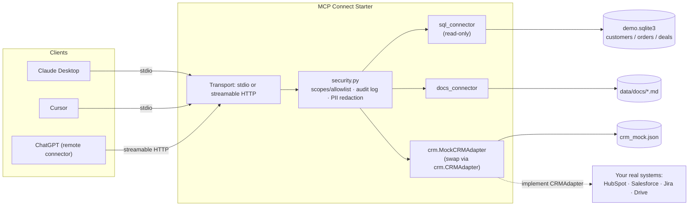

# MCP Connect Starter

[](https://github.com/cdtalley/mcp-connect-starter/actions/workflows/ci.yml)
[](LICENSE)
[](pyproject.toml)

A clean, runnable, production-minded starter for building an **MCP server**
that connects Claude, Cursor, or ChatGPT to your own tools -- with the
security patterns (read-only enforcement, least-privilege scopes, PII
redaction, audit logging) you actually want before you put one in front of
real company data.

**The Model Context Protocol (MCP), in two sentences:** MCP is an open,
JSON-RPC-based protocol that lets an AI assistant discover and call a
server's *tools* (and read its *resources*) over a standard transport --
stdio for local processes, or HTTP for remote ones -- instead of every
assistant and every backend needing a bespoke integration. This repo is a
server: it exposes tools, the assistant (Claude Desktop, Cursor, ChatGPT,
...) is the client that calls them.

Everything below runs with **zero external accounts**: a bundled SQLite
demo database, a bundled markdown knowledge base, and a bundled mock
CRM/ticketing fixture. Clone it, run it, and read the code to see the
patterns -- then swap in your own data and real systems.

---

## Architecture



Every tool call flows through `security.secure_tool`: it checks the
caller-independent, server-side scope/allowlist policy, runs the connector,
redacts PII from the result, and writes a structured audit log line --
regardless of whether the call succeeded, was denied, or errored.

## Quickstart

Requires Python 3.10+.

```bash
git clone <this-repo-url> mcp-connect-starter
cd mcp-connect-starter

# pip
pip install -e ".[dev]"
# ...or uv
uv pip install -e ".[dev]"

# Run the test suite
pytest

# Lint
ruff check .

# Run over stdio (what Claude Desktop / Cursor launch for you)
mcp-connect-starter --transport stdio

# Run over streamable HTTP (for remote use / ChatGPT connectors)
mcp-connect-starter --transport http --host 0.0.0.0 --port 8080
# -> http://0.0.0.0:8080/mcp  (health check: http://0.0.0.0:8080/healthz)
```

The demo SQLite database is created automatically on first run (see
`src/mcp_connect_starter/seed_data.py`); there's nothing to provision.

### Docker

```bash
docker compose up --build
# MCP endpoint:   http://localhost:8080/mcp
# Health check:   http://localhost:8080/healthz
```

## Connecting a client

> These are the connection methods that exist today for each client. Check
> that client's current docs if something here looks out of date -- this
> space moves fast.

### Claude Desktop

Add to your `claude_desktop_config.json` (Settings -> Developer -> Edit
Config):

```json
{
  "mcpServers": {
    "mcp-connect-starter": {
      "command": "mcp-connect-starter",
      "args": ["--transport", "stdio"]
    }
  }
}
```

If `mcp-connect-starter` isn't on the `PATH` Claude Desktop sees, use an
absolute interpreter path instead, e.g.
`"command": "/path/to/venv/bin/mcp-connect-starter"`.

### Cursor

Add to `.cursor/mcp.json` (project-level) or `~/.cursor/mcp.json` (global):

```json
{
  "mcpServers": {
    "mcp-connect-starter": {
      "command": "mcp-connect-starter",
      "args": ["--transport", "stdio"]
    }
  }
}
```

Or, pointed at a server you're already running over HTTP:

```json
{
  "mcpServers": {
    "mcp-connect-starter": {
      "url": "http://localhost:8080/mcp"
    }
  }
}
```

### ChatGPT

ChatGPT's connectors (Settings -> Connectors, on plans that support custom
connectors) call a **remote** MCP server over HTTP -- there is no stdio
option for ChatGPT. Run this server with `--transport http` somewhere
reachable (your own deployment, or a tunnel like `ngrok`/`cloudflared` for
local testing) and register `https://your-host/mcp` as the connector's
server URL.

## Example prompts

These are real tool outputs from the bundled demo data (SQLite
customers/orders/deals, the markdown docs, and the mock CRM), lightly
trimmed. Your assistant decides which tool(s) to call based on the prompt;
this is what comes back.

**"Which companies have the most closed-won deal value?"** -> `sql_query`

```json
{
  "columns": ["company", "total_value"],
  "rows": [
    {"company": "Northfjord Analytics", "total_value": 390000.0},
    {"company": "Fernhollow Foods", "total_value": 95000.0},
    {"company": "Cobalt Reef Robotics", "total_value": 9600.0}
  ],
  "row_count": 3,
  "truncated": false
}
```

**"What's our refund policy?"** -> `search_docs` then `read_doc`

```json
{
  "result": [
    {
      "path": "refund-policy.md",
      "title": "Refund Policy",
      "score": 10,
      "snippet": "# Refund Policy _Last updated: 2024-01-02_ This is sample knowledge-base content bundled with the MCP Connect starter, used to demonstrate t..."
    }
  ]
}
```

**"Show me our open support tickets."** -> `list_tickets`

```json
{
  "result": [
    {
      "id": "TCK-2005",
      "subject": "Robotics telemetry connector dropping packets",
      "status": "open",
      "priority": "P1",
      "requester_email": "[REDACTED_EMAIL]",
      "assignee": "Support: Alex Chen",
      "created_at": "2024-01-10T06:22:00Z",
      "updated_at": "2024-01-10T07:05:00Z",
      "description": "~3% of telemetry packets from the robotics fleet connector are being dropped since last night's deploy.",
      "comments": []
    }
  ]
}
```

Note the requester's email came back redacted -- that's the PII filter
running on every tool call, not something the prompt asked for.

**"Delete the customers table."** -> `sql_query` is called, and rejected
before it ever reaches SQLite:

```
Error executing tool sql_query: Only SELECT (or WITH ... SELECT) statements are allowed.
```

## Security model

This is the part worth reading before you point this at anything real.

**Read-only SQL, enforced twice.**
`security.ensure_read_only_sql` rejects anything that isn't a single
`SELECT` / `WITH ... SELECT` statement -- no `INSERT`/`UPDATE`/`DELETE`,
no DDL, no multi-statement payloads, comments stripped first so a write
can't hide behind `--` or `/* */`. Independently, the SQLite connection
itself is opened via a read-only URI (`mode=ro`) with
`PRAGMA query_only = ON`, so a write fails even if the text-based guard
were somehow bypassed. Queries use `?` placeholders with bound `params` --
never string-formatted values -- and results are capped at
`MCP_CONNECT_SQL_MAX_ROWS` rows (default 200), with a progress-handler
based timeout bounding how long a single query may run.

**Least privilege, per tool.**
Every tool declares the scope(s) it needs (`config/scopes.yaml`). A tool
only runs if the server was explicitly granted every scope it requires
(`MCP_CONNECT_GRANTED_SCOPES`), and `enabled: false` in that file turns a
tool off outright regardless of scopes. The one write-capable tool in the
starter, `add_ticket_comment`, requires `crm:write` and ships **disabled by
default** -- the server is read-only out of the box, on purpose. An
optional hard allowlist (`MCP_CONNECT_ALLOWED_TOOLS`) can further restrict
which tool *names* are exposed at all, independent of scopes.

**PII redaction on every tool output.**
`redaction.py` pattern-matches emails, phone numbers, SSNs, Luhn-validated
card numbers, AWS access keys, and `key=value`-style secrets, replacing
each with a `[REDACTED_<KIND>]` tag. It runs twice: once at the connector
(e.g. the SQL connector redacts `rows` right after fetching them) and once
generically on every tool's return value in `security.secure_tool` --
including inside nested dicts, lists, and Pydantic models -- so a connector
that forgets to redact doesn't leak anything.

**Structured audit logging of every call.**
Every tool invocation -- allowed, denied, or errored -- emits one JSON line
via `audit.py`: a request id, the tool name, status, duration, the scopes
required vs. granted, and the *names* (never values) of the arguments
passed. These always go to **stderr**, never stdout, because stdout
carries the JSON-RPC wire format on the stdio transport and must stay
uncontaminated. Set `MCP_CONNECT_AUDIT_LOG_FILE` to also append them to a
file for shipping to a log pipeline.

**Secrets via environment variables only.**
Every configurable value (`config.py`) is read from an environment
variable with a working default; nothing secret is ever hard-coded or
committed. `.env.example` documents every variable, including the pattern
for a real connector's credentials (e.g. `HUBSPOT_API_KEY`) that the
bundled mock adapter doesn't use but a real one would.

## Repository layout

```
src/mcp_connect_starter/
  server.py              # builds the FastMCP app, registers every tool
  cli.py                 # `mcp-connect-starter` entry point (stdio | http)
  config.py              # all env-driven configuration in one place
  security.py            # scopes/allowlist enforcement + the SQL guard
  redaction.py           # PII pattern matching
  audit.py               # structured JSON audit logging
  seed_data.py           # builds the bundled demo SQLite database
  connectors/
    sql_connector.py     # read-only SQL over the demo database
    docs_connector.py    # markdown knowledge-base search/read
    crm/
      base.py            # CRMAdapter interface + Ticket/Contact models
      mock_adapter.py    # zero-account mock, backed by crm_mock.json
data/
  docs/*.md              # bundled knowledge base
  crm_mock.json          # bundled mock CRM/ticketing fixture
config/
  scopes.yaml            # least-privilege tool policy
tests/                   # pytest: redaction, read-only guard, tool behavior
```

## How to add your own connector

1. **Write the connector.** Create `connectors/your_connector.py` with a
   plain function (sync or async) that takes typed arguments and returns a
   Pydantic model (or a list of them) -- that gives you a real JSON schema
   on the wire for free. Redact PII at the source if your data is likely to
   contain any; the generic filter in `security.secure_tool` is a backstop,
   not a replacement.

2. **Register it as a tool** in `server.py`:

   ```python
   @mcp.tool()
   @secure_tool("your_tool_name", scopes=["your_scope:read"])
   def your_tool_name(arg: str) -> YourResultModel:
       """One sentence the assistant will read to decide when to call this."""
       return your_connector.do_the_thing(arg)
   ```

3. **Add it to `config/scopes.yaml`** with the scope(s) it needs (and
   `enabled: true`/`false`). If you skip this, the tool defaults to
   enabled and requires exactly the scopes you passed to `secure_tool`.

4. **Write a test** in `tests/test_your_connector.py` covering at least
   one success case and one failure/edge case (empty input, not-found id,
   a write attempt if relevant).

### Swapping in a real CRM/ticketing system

`connectors/crm/base.py` defines `CRMAdapter`: `list_tickets`,
`get_ticket`, `search_contacts`, `add_ticket_comment`. The bundled
`MockCRMAdapter` implements it against a JSON fixture. To connect
HubSpot, Salesforce, Jira, Zendesk, or a Google Drive-backed sheet:

```python
# connectors/crm/hubspot_adapter.py
import os
import httpx
from .base import CRMAdapter, Contact, Ticket

class HubSpotAdapter(CRMAdapter):
    def __init__(self):
        self._api_key = os.environ["HUBSPOT_API_KEY"]  # env var only, never committed

    def get_ticket(self, ticket_id: str) -> Ticket:
        resp = httpx.get(
            f"https://api.hubapi.com/crm/v3/objects/tickets/{ticket_id}",
            headers={"Authorization": f"Bearer {self._api_key}"},
        )
        if resp.status_code == 404:
            raise LookupError(f"No such ticket: '{ticket_id}'.")
        resp.raise_for_status()
        return Ticket.model_validate(_map_hubspot_ticket(resp.json()))
    # ... list_tickets, search_contacts, add_ticket_comment ...
```

Then change one line in `server.py`'s `_build_crm_adapter()`:

```python
def _build_crm_adapter() -> CRMAdapter:
    return HubSpotAdapter()  # was: MockCRMAdapter(config.CRM_FIXTURE_PATH)
```

Nothing else changes -- every tool already talks to the adapter only
through the `CRMAdapter` interface. The same pattern applies to Salesforce,
Jira, or a Google Drive-backed connector: implement the interface your
connector needs (or add a new one next to `CRMAdapter` if the shape is
different enough, e.g. a `DocsAdapter` for a live Drive/Confluence sync
instead of `docs_connector`'s local-folder scan), read credentials from
environment variables, and swap the construction site.

## Testing & CI

```bash
pytest          # redaction, read-only SQL guard, and tool behavior
ruff check .     # lint
```

GitHub Actions (`.github/workflows/ci.yml`) runs both on every push and
pull request, across Python 3.10-3.12.

## Configuration reference

See `.env.example` for the full list; the highlights:

| Variable | Default | Purpose |
|---|---|---|
| `MCP_CONNECT_DB_PATH` | `./data/demo.sqlite3` | SQLite database path |
| `MCP_CONNECT_DOCS_DIR` | `./data/docs` | Knowledge-base folder |
| `MCP_CONNECT_CRM_FIXTURE` | `./data/crm_mock.json` | Mock CRM fixture |
| `MCP_CONNECT_SQL_MAX_ROWS` | `200` | Max rows per SQL query |
| `MCP_CONNECT_SQL_TIMEOUT_S` | `5` | Per-query timeout (seconds) |
| `MCP_CONNECT_GRANTED_SCOPES` | `data:read,docs:read,crm:read` | Scopes this deployment holds |
| `MCP_CONNECT_ALLOWED_TOOLS` | _(unset = all)_ | Optional hard tool-name allowlist |
| `MCP_CONNECT_SCOPES_FILE` | `./config/scopes.yaml` | Tool policy file |
| `MCP_CONNECT_AUDIT_LOG_FILE` | _(unset = stderr only)_ | Also append audit JSON lines here |
| `MCP_CONNECT_HTTP_HOST` / `_PORT` | `127.0.0.1` / `8080` | Streamable HTTP bind address |

## License

MIT -- see [LICENSE](LICENSE).

---

### Want this wired into your stack?

This repo is the open-source starting point. **[Prismbase MCP Connect](https://prismbase.ai/mcp-connect)**
is a fixed-price service that takes it the rest of the way: wiring an MCP
server like this one up to your actual systems -- your databases, your
ticketing tool, your CRM, your internal APIs -- behind the same
least-privilege, audited, PII-redacted patterns shown here, and connected
to your team's Claude, Cursor, or ChatGPT.
